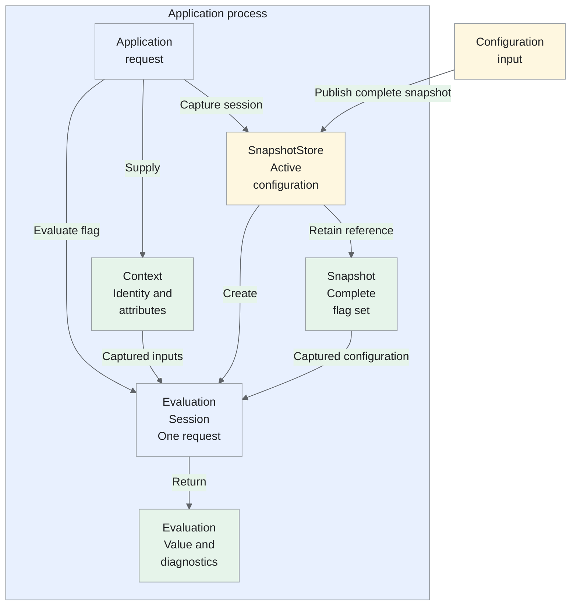
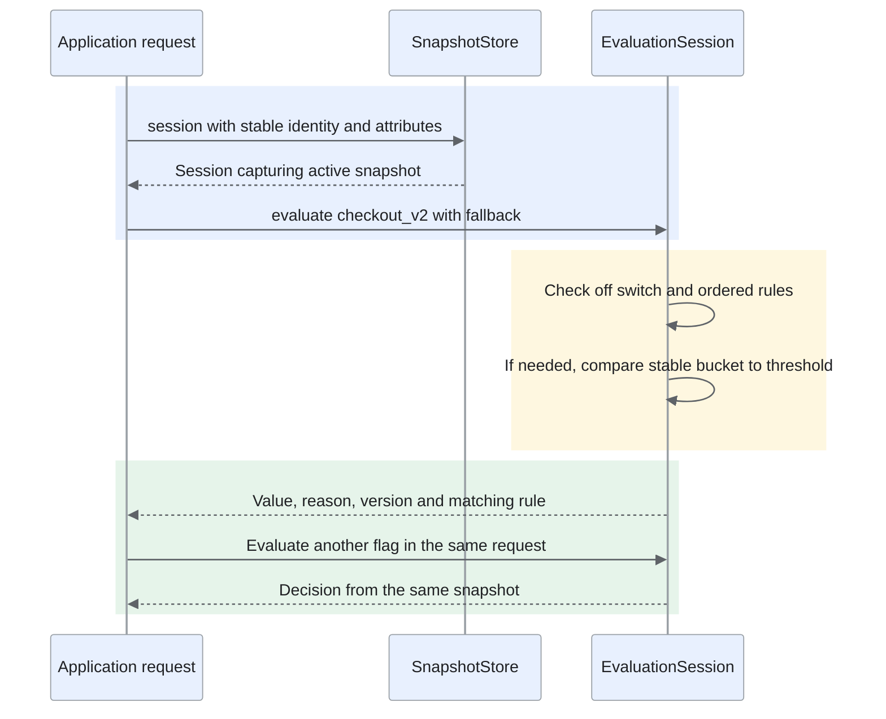
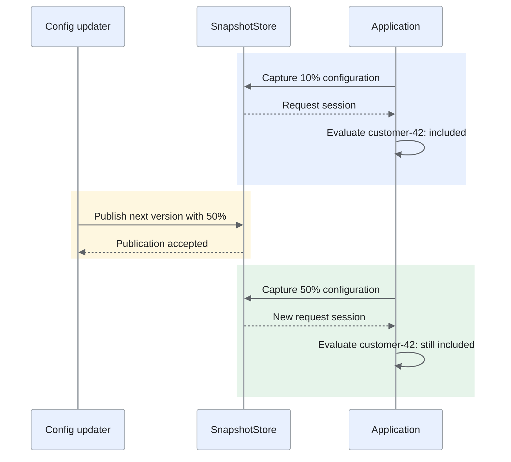
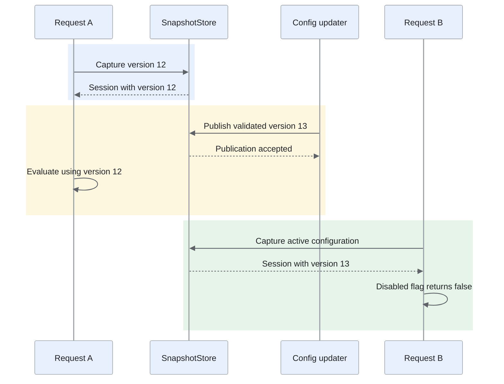
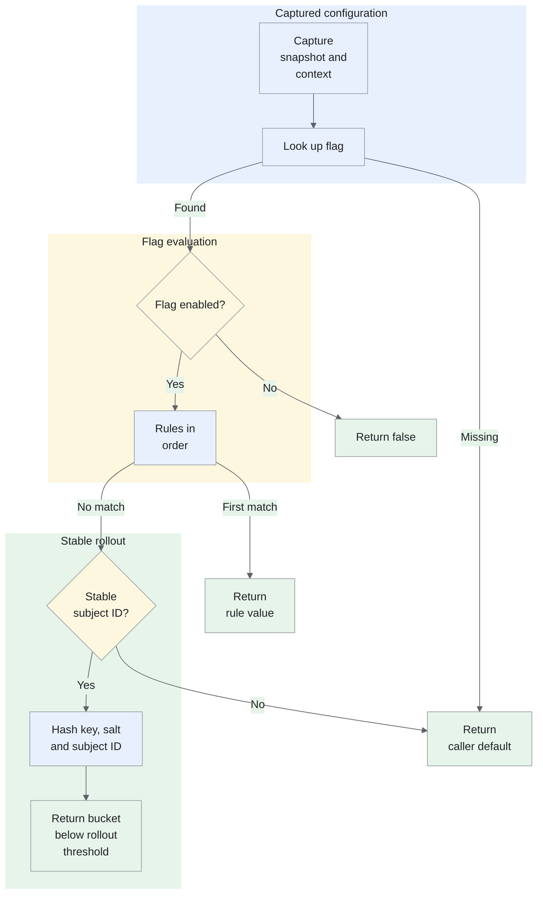
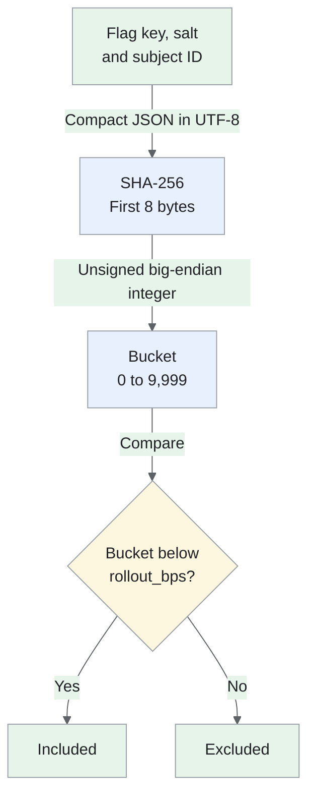

Build a local feature-flag evaluator with ordered rules, stable rollouts and request-consistent configuration.

<!--more-->

## Problem

A team has built a new checkout. They want employees to try it first, then 10% of customers, and eventually everyone. They also need to switch it off if something goes wrong.

The application asks a small library whether `checkout_v2` is enabled for a customer. Customers should not switch between checkouts just because they refresh the page. Within a request, every flag check should use the same configuration, even if an update arrives.

We'll design the part that makes this decision inside the application. The service that stores and distributes flag configuration is outside this design.

## Requirements

### Functional requirements

- **Target a group.** A rule can enable the new checkout for employees, or disable it for an excluded customer segment. Rules run in their configured order; the first match wins.
- **Roll out gradually.** A customer gets a stable position in a rollout. With the other evaluation inputs unchanged, increasing the percentage adds customers without removing those already included.
- **Switch a feature off.** A disabled flag returns `false`, even if a targeting rule would otherwise enable it.
- **Use a fallback.** The caller supplies a default for a missing flag or a rollout that cannot identify the customer. An anonymous customer may still match an explicit targeting rule.
- **Explain a decision.** Return the value, the reason, the configuration version and, when applicable, the rule that matched.
- **Refresh configuration.** Publish a new snapshot without changing the one a request is already using.

### Non-functional requirements

- Evaluation reads memory only: no network, disk or configuration lock on the decision path.
- The same snapshot and context produce the same decision across processes. A rollout does not depend on Python's built-in `hash()` or a fresh random number.
- Configuration and request attributes are immutable once a session captures them. Copy incoming dictionaries rather than exposing a mutable caller-owned mapping.
- Reject invalid rollout thresholds, duplicate rule IDs and stale configuration versions before replacing the active snapshot.
- Make the decision logic easy to test without a running configuration service.

### Out of scope

- Flag administration, authentication and configuration transport or JSON parsing.
- Multivariate experiments, statistical analysis and impression delivery.
- Regular expressions, nested expressions and flag prerequisites. The first version supports string equality with AND within a rule and first-match ordering between rules.

Feature flags are not authorization checks. A customer who is shown a new checkout must still pass the application's normal access and payment checks.

## High-level design

The library runs inside the application process. A **snapshot** is one complete, immutable configuration. `SnapshotStore` holds the active snapshot; the application captures it once in an `EvaluationSession` for each request. That session combines the snapshot with a `Context` containing the customer's identity and attributes, then returns an `Evaluation` for each flag check.



Configuration publication changes the snapshot captured by new sessions. Existing sessions retain their own configuration until their requests finish. The application supplies configuration and handles authentication; this design covers the local evaluator and its publication boundary.

## Core entities

The evaluator captures immutable context and configuration records. The caller supplies attributes and handles authentication; the returned `Evaluation` explains the decision.

```protobuf
message Context {
  // Stable, opaque customer ID; absent for anonymous users.
  optional string subject_id;
  // Copied, read-only inputs, e.g. employee="true".
  map<string, string> attributes;
}

message Condition {
  string attribute;
  string expected; // Exact string equality; a missing attribute fails.
}

message Rule {
  string rule_id;                 // Unique within its flag.
  repeated Condition conditions; // At least one condition; all must match.
  bool value;
}
```

```protobuf
message Flag {
  string key;
  bool enabled;       // false overrides targeting rules and rollout.
  repeated Rule rules; // Evaluate in order; first match wins.
  int32 rollout_bps;  // 0..10,000; 1,000 means a 10% rollout.
  string salt;        // Keep stable to preserve customer assignments.
}

message Snapshot {
  int64 version; // Positive; publication requires a newer version.
  // Complete, immutable configuration; map key = Flag.key.
  map<string, Flag> flags;
}

message Evaluation {
  bool value;
  string reason; // DISABLED, RULE_MATCH, ROLLOUT or a fallback reason.
  int64 version;           // Identifies the captured snapshot.
  optional string rule_id; // Present when a targeting rule matches.
}
```

The application uses `value`; logs and support tools use `reason` and `version`. [OpenFeature's typed values and evaluation details](https://openfeature.dev/docs/reference/concepts/evaluation-api/) use the same separation between application behavior and diagnostics.

## Classes and interfaces

`SnapshotStore` publishes configuration and creates request-scoped sessions. `EvaluationSession` evaluates flags using the snapshot and context captured for that request.

```python
class SnapshotStore:
    _snapshot: Snapshot  # Active configuration for new sessions.

    def __init__(self, initial: Snapshot): ...

    # Reject stale versions; existing sessions retain their captured snapshot.
    def publish(self, candidate: Snapshot) -> None: ...

    # Capture the active snapshot once for this request.
    def session(self, context: Context) -> "EvaluationSession": ...


class EvaluationSession:
    snapshot: Snapshot   # Fixed configuration for the request.
    context: Context     # Fixed identity and attributes for every flag check.

    # Read captured objects; return the value and its diagnostic details.
    def evaluate(self, key: str, default: bool = False) -> Evaluation: ...
```

Targeting rules remain data handled by one equality evaluator. Richer condition types would justify a shared predicate interface. Method implementations and synchronization are covered below.

## Functional scenarios

### Evaluating a flag

At request entry, the application supplies the customer's context to `SnapshotStore.session`. It reuses the returned session for every flag check, passing the flag key and a Boolean fallback to `evaluate`.



The application branches on the returned `value`; the `reason`, configuration `version` and optional `rule_id` explain the result. An employee-targeting rule can select the new checkout. A disabled flag returns `false`, while a missing flag returns the caller's fallback. These outcomes remain distinguishable in diagnostics.

Evaluation reads the session's captured records. The [rule-precedence deep dive](#how-do-overlapping-rules-produce-one-decision) explains how targeting, rollouts and fallbacks interact.

### Expanding a rollout

An administrator increases `checkout_v2` from 10% to 50% and supplies a new configuration version. After publication, new requests capture that version and evaluate the larger rollout. The flag key, salt and customer identity remain unchanged, preserving each customer's rollout position. The flag remains enabled, with the same targeting rules and request attributes.



Other customers become eligible when the larger threshold includes their position. Requests already in progress continue using their captured configuration. The [stable-rollout deep dive](#how-do-percentage-rollouts-preserve-customer-assignments) shows the calculation and the conditions under which membership stays stable.

### Publishing configuration during a request

Request A captures version 12. While it is running, the configuration updater publishes version 13 with the feature switched off. Request A finishes using version 12; a new Request B captures version 13 and sees the disabled feature.



Invalid configuration is rejected before publication; a stale version is rejected by `publish`. Both leave the active snapshot unchanged. An off switch takes effect for new sessions after publication; interrupting an existing request requires an application cancellation policy. The [request-consistency deep dive](#how-do-refreshes-preserve-one-requests-configuration) explains synchronization and retained versions.

## Deep dives

### How do overlapping rules produce one decision?

**Problem.** Several targeting rules may match the same customer and return conflicting values. The evaluator needs predictable precedence, including a feature-wide off switch and a caller-provided fallback.

**Options.**

| Option | Mechanism and benefit | Cost and failure mode |
| --- | --- | --- |
| Combine matching results | Evaluate all matches with a policy such as “deny overrides allow”; useful for cumulative policies. | Requires conflict semantics and more condition checks; a poorly chosen combination can obscure the intended result. |
| Rank by specificity | Prefer the rule judged most specific; reduces manual ordering. | Requires a ranking definition and tie handling; changes to a condition can unexpectedly change precedence. |
| Ordered first match | Evaluate rules in configured order and stop at the first match; precedence is explicit and evaluation can stop early. | Authors must order rules carefully; a broad early rule can shadow later exceptions. |

Use ordered first-match rules, with a separate off switch. This Boolean evaluator needs deliberate targeting precedence and a small local decision path. Configuration order expresses the policy directly; it adds no ranking model or result-combination language.

**How it works.** A missing flag uses the caller's fallback. For an existing flag, the off switch takes precedence, followed by the first matching targeting rule. If no rule matches, an identified customer enters the percentage rollout; an unidentified customer receives the fallback. Every outcome carries the captured version and a diagnostic reason.



All conditions within a rule must match using string equality. With “excluded customer → false” before “employee → true,” an employee in the excluded group receives `false`. Reversing those rules changes that result, which makes ordering part of the configuration contract.

**Tradeoffs and recovery.** The first-match choice trades automatic conflict resolution for explicit authoring responsibility. Condition work grows with the rules inspected before a decision; the rollout hash runs only when targeting leaves the result undecided. Keep regression cases for overlapping rules, missing attributes, off-switch precedence and both fallback values. Validate duplicate IDs and empty rules before publication, and correct a shadowing rule by publishing a newer complete snapshot.

### How do percentage rollouts preserve customer assignments?

**Problem.** Repeated evaluations should keep a customer in the same rollout position. Raising the percentage should add eligible customers while preserving those already included, provided the other decision inputs remain unchanged.

**Options.**

| Option | Mechanism and benefit | Cost and failure mode |
| --- | --- | --- |
| Random choice per call | Sample each evaluation independently; minimal state and useful for independent per-call sampling. | Refreshes can switch a customer's experience, and processes may disagree. |
| Persist assignments | Save a customer-to-variant record; supports audited enrollment, explicit overrides and cohort history. | Needs durable storage and cached records; stale caches delay changes and authority outages affect new enrollment. |
| Stable hash bucket | Derive a repeatable position from identity, flag key and salt; evaluation stays local without per-customer storage. | Changing those inputs or the hash contract reshuffles customers; a percentage is not an exact customer quota. |

Use stable hash buckets because this design needs memory-only Boolean percentage rollout, rather than an enrollment ledger. Explicit customer exceptions fit the ordered rules. Audited enrollment or an exact cohort quota would justify a separate persisted assignment model.

**How it works.** Encode `[flag.key, flag.salt, subject_id]` as a compact JSON array in UTF-8. Hash it with SHA-256, interpret the first eight bytes as an unsigned big-endian integer, and scale it into the 10,000-bucket space. [Python's hashlib](https://docs.python.org/3/library/hashlib.html) supplies the hash primitive; the encoding and bucket formula are this evaluator's contract.



The calculation is `bucket = floor(number × 10,000 / 2^64)`, followed by `bucket < rollout_bps`. A threshold of 1,000 covers 10% of the bucket space; 5,000 covers 50%. The version and threshold stay outside the hash so publishing a larger rollout leaves the customer's bucket unchanged.

With `checkout_v2` and salt `checkout-v1`, the implementation produces these test vectors:

| Customer | Bucket | At 10%: below 1,000 | At 50%: below 5,000 |
| --- | ---: | --- | --- |
| customer-42 | 250 | New checkout | New checkout |
| customer-17 | 4,560 | Old checkout | New checkout |
| customer-91 | 7,524 | Old checkout | Old checkout |

Customer 42 stays included as the threshold rises; customer 17 joins. These are calculated examples, not production measurements. A small customer population can differ from the configured percentage because the threshold selects bucket space rather than a fixed customer count.

**Tradeoffs and recovery.** Stable buckets depend on stable identity, salt, flag key and hash encoding. Changed attributes or targeting rules can still change the final decision, even when the bucket stays fixed. Anonymous customers use the fallback after targeting rules are checked; switching identity at sign-in is a caller-owned product decision.

Keep cross-process and cross-language vectors for UTF-8 encoding, JSON serialization, SHA-256 truncation, byte order and scaling. Treat an algorithm change as a coordinated contract migration. Preserve the old contract until callers and configuration move together; silently changing it can move customers between experiences.

### How do refreshes preserve one request's configuration?

**Problem.** A checkout can check several flags while building one response. If each check uses the latest configuration, a refresh between calls can mix behaviors from different versions.

**Options.**

| Option | Mechanism and benefit | Cost and failure mode |
| --- | --- | --- |
| Read the active snapshot per call | Each evaluation reads a complete current snapshot; simple and quick to adopt updates. | Several calls in one request can observe different versions. |
| Lock configuration for the request | Keep a read lock through the request; several checks share one version. | Slow application work delays publication; an incomplete locking protocol can still allow mixed versions. |
| Capture an immutable snapshot | Briefly capture one reference per request and evaluate against it; decisions share a version and need no configuration lock. | Old generations remain referenced until sessions finish, delaying off-switch adoption for those requests. |

Capture one immutable snapshot per request. The consistency boundary is **one session, one version**. The application reuses that session for every check, allowing publication to proceed independently of request processing.

**How it works.**

1. Build and validate a complete candidate configuration. Copy mappings and freeze the declared record graph so a caller-owned dictionary cannot change it later.
2. In `publish`, acquire the store lock, require a newer positive version, replace the active reference and release the lock.
3. In `session`, acquire the same lock only long enough to capture the active snapshot. The session holds that reference and its immutable context.
4. Evaluate by reading the session's captured objects. Existing sessions keep the previous snapshot; new sessions capture the newly published one.

The [publication scenario](#publishing-configuration-during-a-request) shows those old and new requests side by side. [Python's lock primitive](https://docs.python.org/3/library/threading.html#lock-objects) provides mutual exclusion for the publication/capture boundary. The object reference, rather than a lock held through application work, preserves the session's version.

**Tradeoffs and recovery.** Invalid and stale candidates leave the last valid snapshot active. A rollback publishes earlier settings as a newer version—for example, version 14 can restore version 12's values after version 13. One configuration authority must assign those increasing versions.

Full-copy publication temporarily retains active and candidate data; long-lived sessions and frequent updates can retain additional generations. The runtime can reclaim a snapshot after its last session releases it. Keep sessions request-scoped and release them at request completion. The surrounding application or SDK should monitor snapshot bytes, retained generations, oldest-session age and configuration-delivery health; those metrics are not implemented by this example.

This guarantees request consistency within one session, rather than simultaneous adoption across processes. If delivery stops, the last snapshot stays usable but new settings cannot take effect until delivered and published. An emergency off switch affects new sessions; immediate interruption of existing work needs separate application cancellation.

## Key implementation

The following Python uses the standard library. It accepts typed, already-parsed configuration objects; transport decoding and a public SDK's input-validation layer are outside the example.

### Represent rules and configuration

Frozen dataclasses prevent field reassignment, but do not freeze a nested dictionary. `Context` and `Snapshot` copy their mappings and expose read-only views; rules copy their sequences into tuples. Strings, Booleans and the nested frozen records complete the immutable object graph for the declared types.

```python
from dataclasses import dataclass
from typing import Mapping, Optional, Tuple
from types import MappingProxyType
from threading import Lock
import hashlib
import json


@dataclass(frozen=True)
class Context:
    subject_id: Optional[str]
    attributes: Mapping[str, str]

    def __post_init__(self):
        object.__setattr__(self, "attributes",
                           MappingProxyType(dict(self.attributes)))


@dataclass(frozen=True)
class Condition:
    attribute: str
    expected: str


@dataclass(frozen=True)
class Rule:
    rule_id: str
    conditions: Tuple[Condition, ...]
    value: bool

    def __post_init__(self):
        object.__setattr__(self, "conditions", tuple(self.conditions))
        if not self.rule_id or not self.conditions:
            raise ValueError("A rule needs an ID and at least one condition")
        if type(self.value) is not bool:
            raise ValueError("A rule's result must be Boolean")

    def matches(self, context: Context) -> bool:
        return all(context.attributes.get(c.attribute) == c.expected
                   for c in self.conditions)


@dataclass(frozen=True)
class Flag:
    key: str
    enabled: bool
    rules: Tuple[Rule, ...]
    rollout_bps: int
    salt: str

    def __post_init__(self):
        object.__setattr__(self, "rules", tuple(self.rules))
        if not self.key or not self.salt or type(self.enabled) is not bool:
            raise ValueError("A flag needs a key, salt and Boolean state")
        if type(self.rollout_bps) is not int or not 0 <= self.rollout_bps <= 10000:
            raise ValueError("Rollout must be an integer from 0 to 10000")
        ids = [rule.rule_id for rule in self.rules]
        if len(ids) != len(set(ids)):
            raise ValueError("Rule IDs must be unique within a flag")


@dataclass(frozen=True)
class Snapshot:
    version: int
    flags: Mapping[str, Flag]

    def __post_init__(self):
        flags = dict(self.flags)
        if type(self.version) is not int or self.version < 1:
            raise ValueError("Version must be a positive integer")
        if any(key != flag.key for key, flag in flags.items()):
            raise ValueError("Mapping keys must match their flag keys")
        object.__setattr__(self, "flags", MappingProxyType(flags))


@dataclass(frozen=True)
class Evaluation:
    value: bool
    reason: str
    version: int
    rule_id: Optional[str] = None
```

`rollout_bps` uses basis points: 100 basis points equal one percentage point. Integers avoid ambiguity about whether a setting such as `0.1` means 0.1% or 10%.

### Make one decision

Encode the hash inputs as a JSON array, rather than joining them with a delimiter that might appear in an ID. Use the first eight bytes of SHA-256 to select a bucket from `0` to `9,999`. The salt is stable configuration; changing it deliberately reshuffles the cohort.

```python
def stable_bucket(flag: Flag, subject_id: str) -> int:
    payload = json.dumps(
        [flag.key, flag.salt, subject_id],
        ensure_ascii=False, separators=(",", ":"),
    ).encode("utf-8")
    number = int.from_bytes(hashlib.sha256(payload).digest()[:8], "big")
    return number * 10000 // (1 << 64)


@dataclass(frozen=True)
class EvaluationSession:
    snapshot: Snapshot
    context: Context

    def evaluate(self, key: str, default: bool = False) -> Evaluation:
        flag = self.snapshot.flags.get(key)
        version = self.snapshot.version
        if flag is None:
            return Evaluation(default, "FLAG_NOT_FOUND", version)
        if not flag.enabled:
            return Evaluation(False, "DISABLED", version)
        for rule in flag.rules:
            if rule.matches(self.context):
                return Evaluation(rule.value, "RULE_MATCH", version, rule.rule_id)
        if not self.context.subject_id:
            return Evaluation(default, "MISSING_SUBJECT", version)
        bucket = stable_bucket(flag, self.context.subject_id)
        return Evaluation(bucket < flag.rollout_bps, "ROLLOUT", version)
```

The hash does not include the configuration version or percentage. Those change when a rollout grows; including them would move customers to new buckets and undo the stable assignment. The flag key keeps assignments independent between flags.

### Publish a snapshot

Build and validate a complete candidate before calling `publish`. The lock protects the pointer swap and session capture, not the evaluation itself. In-flight sessions keep their old snapshot through an ordinary object reference.

```python
class SnapshotStore:
    def __init__(self, initial: Snapshot):
        self._snapshot = initial
        self._lock = Lock()

    def publish(self, candidate: Snapshot) -> None:
        with self._lock:
            if candidate.version <= self._snapshot.version:
                raise ValueError("Configuration version must increase")
            self._snapshot = candidate

    def session(self, context: Context) -> EvaluationSession:
        with self._lock:
            snapshot = self._snapshot
        return EvaluationSession(snapshot, context)
```

A delayed version 12 cannot overwrite version 13. A rollback of flag values would be a new version 14 containing the older settings, not an exception to the version rule. This assumes one configuration authority supplies monotonically increasing versions.

### A worked example

While the flag is enabled, employees get the new checkout regardless of percentage. Other identified customers enter the rollout. The request creates one session and passes it to the components that need a flag decision.

```python
staff = Rule("employees", (Condition("employee", "true"),), True)
flag = Flag("checkout_v2", True, (staff,), 1000, "checkout-v1")
store = SnapshotStore(Snapshot(12, {flag.key: flag}))

session = store.session(Context("customer-42", {"employee": "false"}))
decision = session.evaluate("checkout_v2", default=False)
assert decision == Evaluation(True, "ROLLOUT", 12)

# A refresh affects new sessions, not the request already in progress.
off = Flag("checkout_v2", False, (staff,), 1000, "checkout-v1")
store.publish(Snapshot(13, {off.key: off}))
assert session.evaluate("checkout_v2").value is True
assert store.session(session.context).evaluate("checkout_v2").reason == "DISABLED"
```


## Edge cases and tests

Test the decision contract, not just the happy path:

- A missing flag returns the caller's default with `FLAG_NOT_FOUND`, including when the default is `true`.
- A disabled flag returns `false` even for an employee and even when the caller's default is `true`.
- The first matching rule wins when two rules disagree; missing attributes do not match.
- An anonymous subject uses the fallback after rules have been checked.
- The threshold comparison is strict: bucket 1,000 is excluded at a 10% threshold. For identified subjects reaching the rollout branch, zero excludes all and 10,000 includes all.
- The same subject stays in the cohort when only the threshold increases. Restarting the process produces the same bucket.
- Invalid candidates and stale versions leave the active snapshot unchanged. A source dictionary changed after construction cannot change a snapshot or context.
- Publishing while requests capture sessions yields complete old or new snapshots, never a mixture. Sessions captured before publication keep the old result.

The example also needs a caller-chosen identity policy. Switching from an anonymous device ID to an account ID at sign-in can change an assignment; that is a product decision, not a hash defect. This first version falls back for anonymous users rather than inventing an identity.

## Extensions and trade-offs

Keep the first version Boolean and equality-only. Add typed variants or richer predicates when a real use case needs them, with matching typed defaults and validation. Add reusable segments before copying large customer lists into every rule. If prerequisites are introduced, validate their dependency graph and define how missing or cyclic references behave.

Snapshot capture gives consistency within one request, not simultaneous updates across all application processes. If configuration delivery stops, the last valid snapshot remains usable, but an off switch cannot take effect until it arrives and a new session captures it. Delivery health and maximum configuration age belong in the surrounding SDK, not in `evaluate`.
