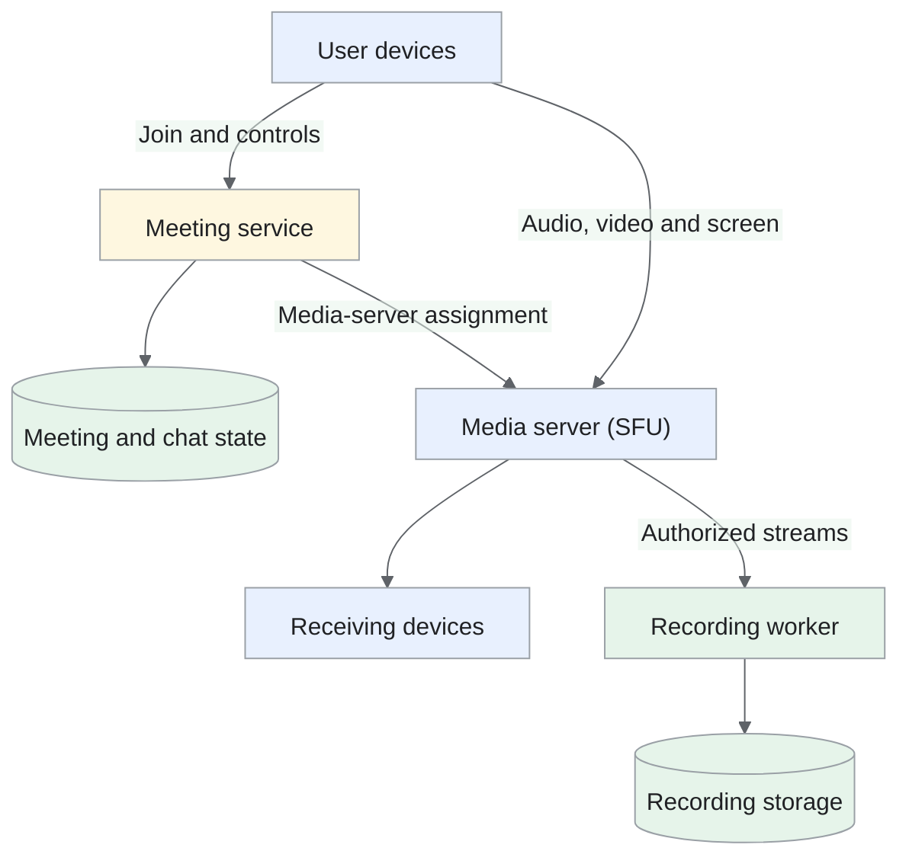
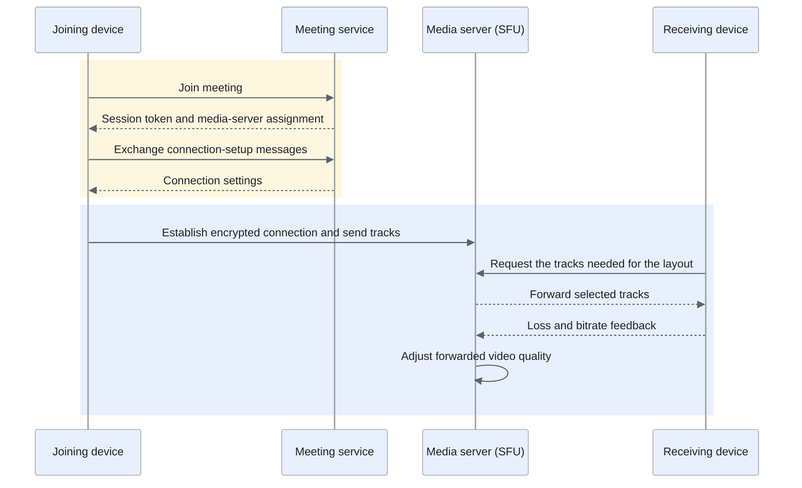
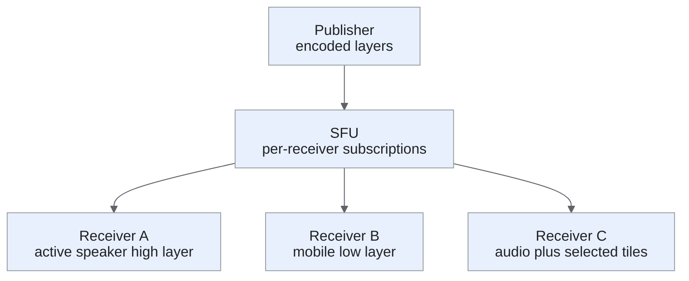
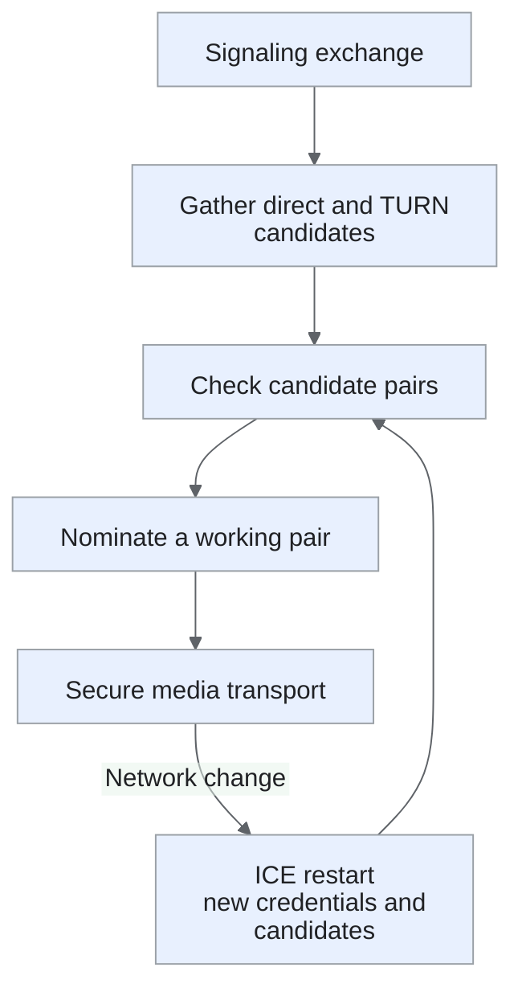
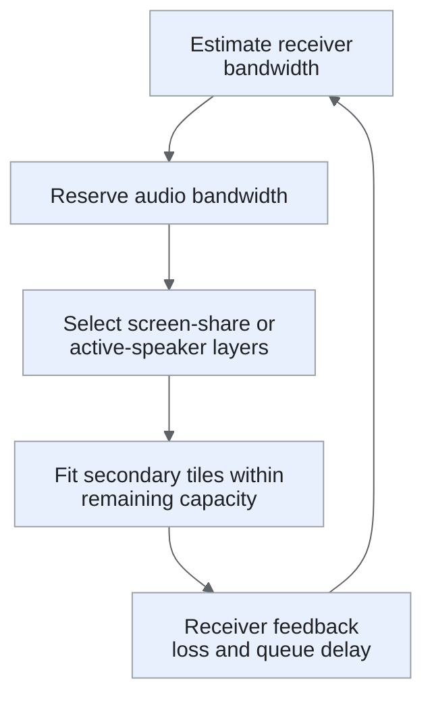
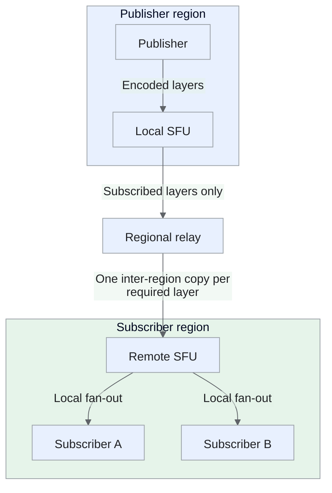

Design of a meeting service with live audio, video, screen sharing, chat and optional recording.

<!--more-->

## Problem

Users need to join a meeting quickly, hear each other clearly and share content across home, mobile and corporate networks. Each participant has a different connection and device, so the service must adapt the streams delivered to each receiver.

Meeting setup and host controls need reliable delivery. Live audio and video need to arrive in time for playback, so they use a separate transport that can favor timely packets over retransmitting outdated media.

## Requirements

### Functional requirements

- **Manage meetings:** create and join meetings, maintain the participant roster and enforce host permissions.

- **Exchange media:** send microphone and camera streams and receive other participants' audio and video.

- **Share a screen:** show a participant's screen alongside the meeting's camera feeds.

- **Adapt quality:** adjust video quality and preserve audio as network conditions change.

- **Chat and react:** deliver meeting messages and lightweight reactions.

- **Record a meeting:** save permitted audio, video and screen content for authorized users.

### Non-functional requirements

Design targets:

- **Scale:** 10M concurrent participants, including meetings with up to 1,000 participants.

- **Latency:** capture-to-playback delay under 150ms at p95 for supported regional network conditions; join within three seconds at p95.

- **Availability:** 99.9% for meeting setup; target media recovery within five seconds after a single media-server failure.

- **Security:** authenticated access and encrypted connections; optional end-to-end encryption (E2EE) keeps media decryption keys with authorized participants.

- **Resilience:** reduce video quality and preserve audio during congestion; display reconnection state when a path fails.

Intercontinental propagation, device processing and restrictive networks can exceed the latency target. Webinars, telephone dial-in and breakout rooms are outside this design.

## Back-of-the-envelope calculations

- **Media ingress:** 10M × 2Mbps average uplink = 20Tbps, before transport overhead.

- **Stream deliveries:** if all 20 participants receive everyone else's stream, the meeting has 20 × 19 = 380 receiver/stream relationships. Outbound bandwidth depends on visible tiles and their selected bitrates.

- **Connectivity relay traffic:** a relay carries media when a device cannot connect directly to the media server. With 10% of participants relaying 2Mbps in each direction, about 4Tbps of media payload crosses the relay path. Relay interfaces handle about 4Tbps ingress plus 4Tbps egress before overhead. The design uses [TURN](https://www.rfc-editor.org/rfc/rfc8656.html), the standard protocol for this relay path; measure the actual relay share and downstream bitrate mix.

- **Recording:** 5M recordings/day × 45 minutes × 1.5Mbps / 8 ≈ 2.5PB/day for one retained media stream per recording. Recording several streams separately multiplies this by the retained stream count.

Bandwidth, recording retention and per-meeting fan-out determine capacity; server counts require measured forwarding throughput.

## Core entities

A **track** is one microphone, camera or screen stream. The model records which participants belong to a meeting, which tracks they send and which media server handles each participant's connection.

- **Meeting:** access policy, host and current lifecycle state.

- **Participant:** identity and permissions within a meeting.

- **Media session:** the participant's connection and assigned media server.

- **Recording:** retained track objects, consent and processing state.

```protobuf
message Meeting {
  string meeting_id;
  string host_user_id;
  string status;
  string encryption_mode;         // Transport or end_to_end
  Timestamp created_at;
}

message Participant {
  string participant_id;
  string meeting_id;
  string user_id;
  string role;
  bool recording_consent;
}

message MediaSession {
  string session_id;
  string participant_id;
  string forwarding_node;          // Assigned media server
  int64 assignment_epoch;          // Server-assignment version
  repeated string published_tracks; // Tracks this participant sends
}

message Recording {
  string recording_id;
  string meeting_id;
  string status;
  repeated string track_objects;
  Timestamp started_at;
}

message ChatMessage {
  string message_id;
  string meeting_id;
  string sender_id;
  int64 sequence;
  string body;
}

```
## API

Meeting creation, joining and recording use HTTP endpoints. After joining, the client opens a WebSocket control connection for **signaling**: the exchange of setup messages, host controls and chat. Live media needs connection negotiation, encrypted transport and feedback about network conditions; the browser's [WebRTC standard](https://www.w3.org/TR/webrtc/) supplies these capabilities.

An `offer` describes media formats and connection settings; the `answer` supplies the other side's accepted settings. An `ice_candidate` carries a possible network address. [Interactive Connectivity Establishment (ICE)](https://www.rfc-editor.org/rfc/rfc8445) tests these possible paths, including a TURN relay when needed, and selects a working address pair.

```yaml
POST /v1/meetings:
  body: {access_policy: object, encryption_mode: string}
  response: {meeting_id: string, join_url: string}

POST /v1/meetings/{meeting_id}/join:
  body: {user_token: string, device_capabilities: object}
  response: {participant_id: string, session_token: string, signaling_url: string,
             media_server: string, session_epoch: integer, assignment_epoch: integer}

WebSocket /v1/meetings/{meeting_id}/signal:
  commands: [offer, answer, ice_candidate, subscribe, host_control, chat, reaction]
  envelope: {command_id: string, session_epoch: integer, assignment_epoch: integer, payload: object}

POST /v1/meetings/{meeting_id}/recordings:
  headers: {Idempotency-Key: recording-request}
  response: {recording_id: string, status: starting}

POST /v1/recordings/{recording_id}/stop:
  response: {status: processing}

GET /v1/recordings/{recording_id}:
  response: {status: string, authorized_download_url: string}

```

Signaling commands have IDs so retries can return the existing result. Retained chat messages have sequence numbers so reconnecting clients can request messages they missed.

## High-level design

The meeting service checks access and assigns a media server to each participant. Each participant sends its streams to that server, which forwards the streams requested by receiving devices. Each device keeps one media-server connection as the meeting grows. This forwarding role is called a [selective forwarding unit (SFU)](https://www.rfc-editor.org/rfc/rfc9605.html#section-6.1).

A device tells the SFU which streams it wants to receive as the user changes the meeting layout. A recording worker receives authorized streams and saves them; meeting and chat records use separate storage.


## Storage

- **Relational database — [PostgreSQL](/designs/tech-postgresql/):** meeting metadata, permissions, recording jobs and retained chat need durable transactions and indexed access by meeting. A transaction saves a chat message, its unique message ID and its meeting-local sequence together, supporting retry deduplication and ordered replay.

- **In-memory key-value store — [Redis](/designs/tech-redis/):** session-routing, participant-list and presence snapshots need fast lookups and expiry. These are short-lived coordination records; durable permissions remain in PostgreSQL. Media servers retain established connection state so they can continue forwarding during a temporary cache outage.

- **Object storage:** immutable recording segments, manifests and final outputs support large sequential writes and authorized downloads. A manifest identifies the segments that completed before an interruption.

- **Durable job queue:** recording finalization and retention work are replayable jobs, separate from the live meeting.

Chat retention follows the meeting policy. Media packets remain in bounded transport and retransmission buffers; recording is an explicit operation.

## From request to response

### Meeting join and media flow



The meeting service handles access and connection setup; the SFU handles live media delivery. Once a device connects, it sends its tracks to the SFU and requests the tracks it needs to receive. A TURN relay can carry the device-to-SFU connection when direct connectivity is unavailable.

### Joining a meeting

The client authenticates and submits the meeting ID. The meeting service checks access and capacity, creates a participant session and returns a short-lived signaling token and a media-server assignment.

The client exchanges its supported media formats and possible network addresses through signaling. ICE checks those address pairs and chooses a working direct or TURN-relayed path. After the encrypted media connection is established, the client starts sending tracks and requesting the tracks it needs to receive.

On reconnect, the participant identity stays the same but the connection version (`session_epoch`) advances. A change of assigned media server advances `assignment_epoch` separately. The service rejects commands carrying an older relevant version.

### Sending and receiving audio and video

The client uses a **codec**, an audio or video encoder/decoder, to compress each track for transmission. Sending a track is called **publishing**; requesting another participant's track is **subscribing**. For video, the client can send multiple quality versions or quality layers so the SFU can select an appropriate bitrate for each receiving device.

The SFU uses each receiver's requested tracks and network feedback to select what it forwards. Receivers briefly queue incoming packets to smooth arrival-time variation, then decode and play the streams. The quality-control deep dive explains how those versions and layers are encoded and selected.

Audio receives priority during congestion. Forwarding all camera streams at full quality grows downstream bandwidth rapidly; selective subscriptions and layer selection address that cost.

### Sharing a screen

A user with permission publishes a screen track alongside the camera. The client selects encoding settings appropriate to text or motion. Receiving clients update their layouts, and the SFU adjusts the forwarded tracks and video quality to match their requests.

Stopping sharing unpublishes that track. Host controls request a permitted action; device permissions and the user's microphone/camera controls remain enforced by the client.

### Sending chat and reactions

The meeting service validates membership and assigns a sequence to a retained chat message before acknowledging it. Repeated message IDs return the existing result. Reconnecting clients request messages after their last sequence.

Reactions are short-lived events and can tolerate loss. Separating their retention prevents high reaction rates from expanding the durable chat log.

### Recording a meeting

The host starts an authorized recording and participants see its state and consent requirements. A recording subscriber receives permitted tracks, writes segments and records progress in a manifest. Finalization assembles the output and updates the recording status.

Transport-encrypted meetings can support a trusted cloud recorder. End-to-end encrypted meetings require an explicitly authorized key-holding recorder or client-side recording, according to the meeting policy.

## Deep dives

### Which media topology fits group meetings?

A group call creates many subscriptions, and users have limited uplink and decoding capacity.

- **Peer-to-peer mesh:** Send a separate copy from each publisher to every peer. Small calls avoid a forwarding server, but uplink and connection count grow with participants.

- **Server mixing:** Decode streams and encode a composite for each needed layout. Receiver decoding can be lighter, but server compute, latency and end-to-end trust constraints increase.

- **Selective forwarding — recommended:** Forward existing encoded streams and select subscriptions/layers per receiver. Server encoding work is avoided; receiver bandwidth and decode limits still require bounded visible tiles and layer choices.

In a 20-person mesh, sending a 2Mbps camera stream separately to 19 peers requires 38Mbps of upload bandwidth per participant. Selective forwarding sends a bounded set of quality versions to one media server, which distributes them to receivers. We choose it because client upload bandwidth and server encoding capacity are limited. The cost moves to server outbound bandwidth and per-receiver subscription state; mixing remains useful for authorized recording or constrained clients.

The [Real-time Transport Protocol (RTP) topology specification](https://www.rfc-editor.org/rfc/rfc7667.html#section-3.7) describes these packet-forwarding and mixing approaches. Bound the number of visible video subscriptions so each device stays within its receive-bandwidth and decoding capacity.

Switch video quality at a **keyframe**, which starts a fresh decoding point without depending on earlier video frames, or at a switching point supported by the codec. Packet sequence numbers identify ordering; a quality switch also has to preserve the decoder's required frame dependencies. The SFU keeps bounded packet history for retransmission and requests keyframes when required.

**What the SFU forwards**

A publisher sends video using **simulcast**, several independently encoded quality versions, or **scalable video coding**, a base layer with enhancement layers that add quality. The SFU forwards a suitable version or decodable set of layers for each subscription: high quality for a large active-speaker tile, lower quality for a small mobile tile. Receiving devices decode their selected streams and compose their own meeting layouts.

For a mesh of N participants, each publisher sends up to N-1 copies. With forwarding, the publisher sends a bounded set of encoded layers; server egress still scales with subscriptions and must be budgeted.



On a layout change, the receiver requests a new subscription. The SFU switches at a codec-valid point and uses a keyframe request when necessary. Keep bounded packet history for retransmission; a packet whose playback deadline passed is dropped rather than indefinitely queued. Measure sender uplink, SFU egress and receiver decode load separately.

### How do meetings survive restrictive networks?

A direct **UDP** media path sends individual packets without waiting for transport-level retransmission. This suits time-sensitive audio/video, but firewalls and network address translation (NAT) can prevent a device from reaching the SFU directly.

- **Direct transport only:** Use a direct supported media candidate. Relay spending is low, but restrictive NATs or firewalls prevent some participants from connecting.

- **Relay every session:** Route all media through TURN infrastructure. Connectivity handling is uniform, but even reachable sessions pay relay bandwidth and an extra network path.

- **ICE with relay fallback — recommended:** Check candidate pairs and use a working direct or TURN path. Most sessions can avoid unnecessary relay; candidate setup, relay capacity and connectivity metrics remain required.

Participants use heterogeneous enterprise and mobile networks. We accept connectivity-check setup and provision measured TURN capacity so reachability does not depend on one assumed UDP path.

Deploy TURN near users, require short-lived credentials and monitor allocations, relay bandwidth and transport mix. TURN can use TCP, optionally protected by Transport Layer Security (TLS), for restrictive networks. TCP delivers data in order, so a missing packet can delay newer media behind its retransmission; this is head-of-line blocking.

An ICE restart establishes a replacement path after a network change. Retrying signaling alone does not repair a failed media transport.

**Connection establishment and network change**

Signaling exchanges connection credentials and candidate addresses. ICE tests candidate pairs and selects a working path; TURN supplies a device-to-SFU relay path when direct connectivity is unavailable. An **ICE restart** exchanges new credentials and candidates to establish a replacement path after a network change.



The media path carries authenticated encrypted transport independently of signaling. A healthy WebSocket does not imply healthy audio/video. Keep metrics for candidate type, RTT, loss and relay use so connectivity failures can be localized.

TURN allocations require bounded lifetimes and short-lived credentials, with per-user abuse limits. A TCP/TLS fallback improves reachability but can delay newer media behind a lost packet. Test enterprise firewalls and Wi-Fi-to-mobile handoff with real clients. After a path changes, adapt congestion estimates instead of immediately sending the old high bitrate over the new link.

### How do we keep quality consistent across receivers?

A fast connection and a congested mobile connection can subscribe to the same publisher.

- **One fixed quality:** Publish and forward one bitrate/resolution. Operation is simple, but a congested receiver stalls or a fast receiver receives unnecessarily low quality.

- **Per-receiver transcoding:** Decode and re-encode a tailored stream for every receiver. Adaptation is flexible, but compute and latency scale with subscriptions.

- **Encoded layers with receiver feedback — recommended:** Select a simulcast or scalable-codec layer per subscription and adjust sender bitrate as needed. Heterogeneous receivers share published layers; publishers spend extra encoding/uplink and transitions need congestion control.

A meeting contains different devices and bandwidth conditions. We accept layer-management and publisher overhead to preserve audio and useful visible video without individualized server transcoding.

Use receiver feedback, queue delay and packet loss to estimate available capacity. Allocate audio first, then screen content or the active speaker, then other tiles. A **jitter buffer** briefly holds arriving packets to smooth network timing variation; bound that buffer and the retransmission deadline so old packets do not prolong congestion.

Load tests cover loss, bursty delay, mobile handoff and changing subscription layouts. Measure frozen-frame time and audio interruptions alongside bitrate.

**Allocate bandwidth per receiver**

Estimate a receiver's available budget from transport feedback and queue delay. Reserve audio first, then screen content/active speaker, then selected secondary tiles. Choose existing encoded layers that fit that budget and request sender adaptation when none is feasible.



Require sustained spare bandwidth before upgrading quality; this **hysteresis** prevents small fluctuations from repeatedly switching layers. Downgrade sooner when loss or queue delay rises, and stop retransmitting packets after their playback deadline. Longer jitter buffering adds conversation delay, so keep it within the playback budget.

Feedback is per subscription, so a slow receiver does not automatically force all participants to the same quality. Sender CPU/uplink limits still constrain the available layers. Test the full interaction under loss and bursts, reporting audio gaps and frozen-frame time in addition to average bitrate.

### How do we route a meeting across regions?

One region is operationally simple, but users far from that region pay extra propagation delay.

- **One meeting region:** Keep all media on one regional forwarding group. Ownership and relay relationships are simple, but distant participants pay additional propagation delay.

- **Local SFU per participant:** Attach everyone to a nearby forwarding node. Access paths are short, but cross-region subscriptions and many relay relationships become difficult to coordinate.

- **Regional SFU groups — recommended:** Group nearby participants and relay only subscribed streams between regions. Access latency and relay work are balanced; meeting routing and SFU recovery must preserve subscription state and server-assignment versions.

Large meetings can span regions while only selected tracks are visible. We accept cross-region routing state and measured relay bandwidth, keeping small local meetings on the simpler one-region path.

The meeting service's **placement controller** chooses a media server using participant locations, capacity and data-residency requirements. Media servers retain current connection and subscription state so established media can continue during a controller restart.

On SFU failure, clients receive a new assignment, establish a new transport and republish or resubscribe. Capacity reserves and regional admission limits keep failover from overloading healthy nodes. The recovery target remains a measured objective, rather than a guarantee for every network.

**A cross-region subscription**

Assign each participant to a nearby SFU with available capacity. An **inter-region relay** carries the required streams between regional SFUs when subscribers are in another region; the receiving SFU distributes them locally. This connects media servers to one another, while TURN handles a device's connectivity to its SFU.



The placement controller owns server assignments and their versions; media servers handle active packet forwarding. Established media can continue through a controller restart using retained connection state. After a media-server failure, affected clients need a new connection, restored track subscriptions and a fresh decoding start.

Reserve failover capacity before accepting meetings at the advertised target. Reassignment advances `assignment_epoch`. Once a client has received a newer assignment, it discards older assignment responses; media servers reject commands carrying old assignment or connection versions. These checks prevent delayed control messages from overriding newer session state. Data-residency constraints can override nearest-region placement; expose that policy to the participant.

### How does end-to-end encryption change recording and trust?

Transport encryption secures each client/server leg. End-to-end encryption additionally protects media payloads from the forwarding service.

- **Transport encryption:** Encrypt each client/server leg while trusted servers can process media. Recording and mixing are available, but the service remains inside the content trust boundary.

- **Client-managed media encryption:** Encrypt payloads with endpoint-held keys beyond transport security. Forwarders cannot read content, but key distribution, device trust and recording features require endpoint support.

- **Explicit meeting trust modes — recommended:** Choose and disclose a compatible encryption/recording mode before joining. Capabilities have a clear trust contract; mode negotiation and participant-visible changes add product and key-management work.

A server recording feature and a server-blind media mode have different trust requirements. We accept explicit mode limits and audited key handling rather than presenting incompatible features as available under one opaque setting.

In E2EE mode, clients encrypt media frames before sending them to the SFU, which uses visible routing metadata to forward them. [Secure Frame (SFrame)](https://www.rfc-editor.org/rfc/rfc9605.html) provides a standardized frame-encryption format. A separate, reviewed group-key protocol authenticates participating devices, distributes keys to authorized members and updates them as membership changes.

A member who receives media keys can access that meeting's media. Membership verification, consent and client security therefore remain part of the trust model.

**Trust boundaries and recording**

In transport-encrypted mode, the SFU terminates the transport and trusted server recording can process payloads. In client-managed media encryption mode, forwarding uses routing metadata while payload decryption belongs to authorized meeting members.

```mermaid
%%{init: {'theme':'base','htmlLabels':false,'flowchart':{'htmlLabels':false},'themeVariables':{'fontFamily':'Arial, sans-serif','primaryColor':'#e8f0fe','primaryTextColor':'#202124','primaryBorderColor':'#9aa0a6','lineColor':'#5f6368','secondaryColor':'#e6f4ea','tertiaryColor':'#fef7e0','actorBkg':'#e8f0fe','actorBorder':'#9aa0a6','actorTextColor':'#202124','noteBkgColor':'#fef7e0','noteTextColor':'#202124','noteBorderColor':'#9aa0a6','signalColor':'#5f6368','signalTextColor':'#202124','labelBoxBkgColor':'#fef7e0','labelBoxBorderColor':'#9aa0a6'}}}%%
flowchart TB
  subgraph TRANSPORT["Transport encryption · service can process media"]
    T1["Sending client"] <-->|"Encrypted transport"| S["Trusted media service<br>can decode or record"]
    S <-->|"Encrypted transport"| T2["Receiving client"]
  end
  subgraph E2EE["End-to-end encryption · clients hold media keys"]
    E1["Authorized sending client<br>encrypts payload"] -->|"Encrypted media"| F["Forwarding service<br>routing metadata only"]
    F -->|"Encrypted media"| E2["Authorized receiving client<br>decrypts payload"]
  end
  style TRANSPORT fill:#fef7e0,stroke:#9aa0a6,color:#202124
  style E2EE fill:#e6f4ea,stroke:#9aa0a6,color:#202124
classDef request fill:#e8f0fe,stroke:#9aa0a6,color:#202124;
classDef data fill:#e6f4ea,stroke:#9aa0a6,color:#202124;
classDef control fill:#fef7e0,stroke:#9aa0a6,color:#202124;
classDef danger fill:#fce8e6,stroke:#9aa0a6,color:#202124;
class T1,S,T2,E1,F,E2 request;
```



Give each sender distinct media keys and an increasing frame counter; receivers reject replayed frames. A sender restarts its counter only after changing its key, keeping each encryption key/counter pair unique. After a member leaves or is removed, deliver fresh keys only to remaining authorized devices. Previously received keys or decoded media remain part of the prior trust exposure. Authenticate the participant list and host actions so signaling manipulation cannot silently add a receiver.

If E2EE recording is required, use an explicitly authorized recording participant/client under the chosen trust policy, rather than claiming the SFU can decrypt transparently. Display the mode and consent before joining. Verify key-rotation and late-join behavior against the reviewed protocol version; a generic “encrypted” label does not explain who can access the content.
