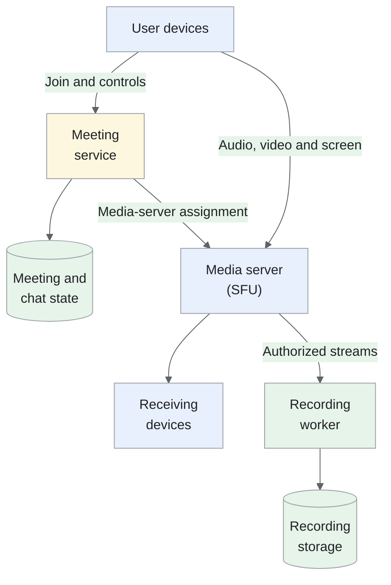
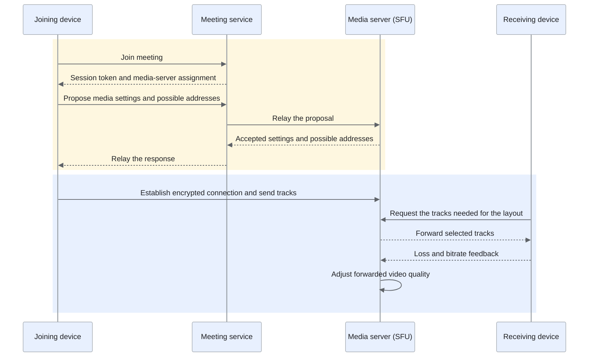
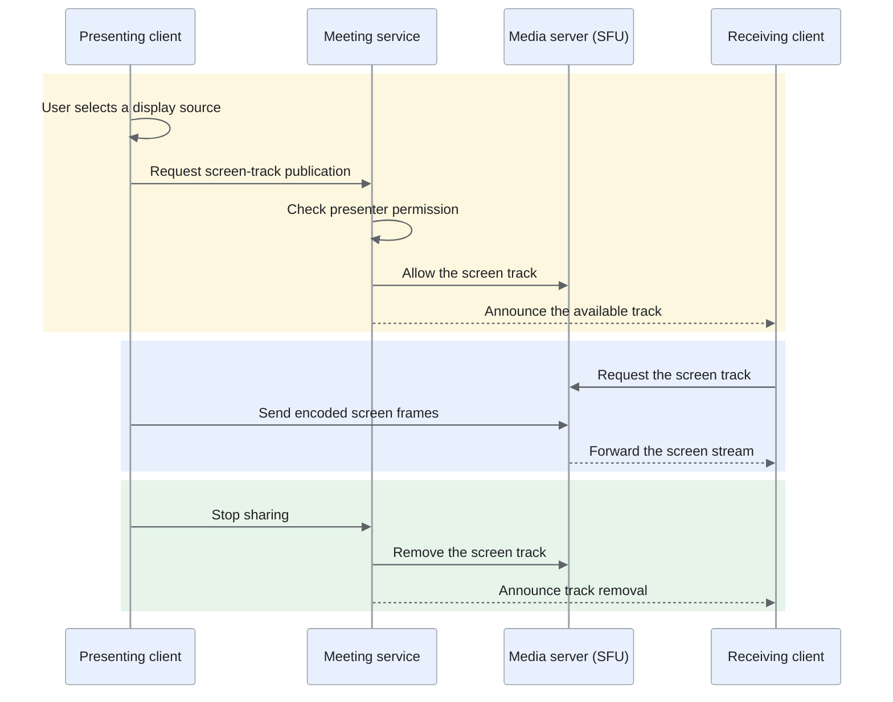
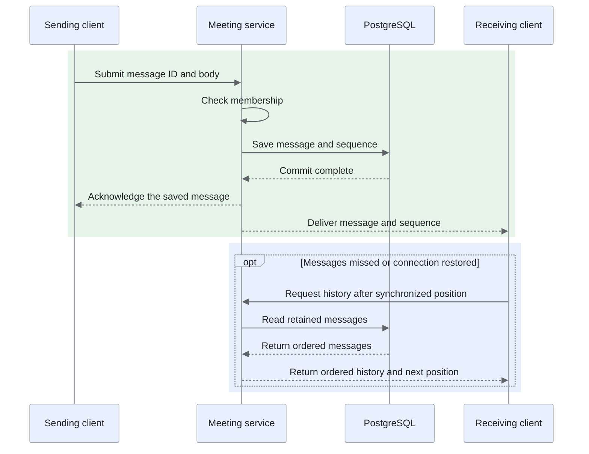
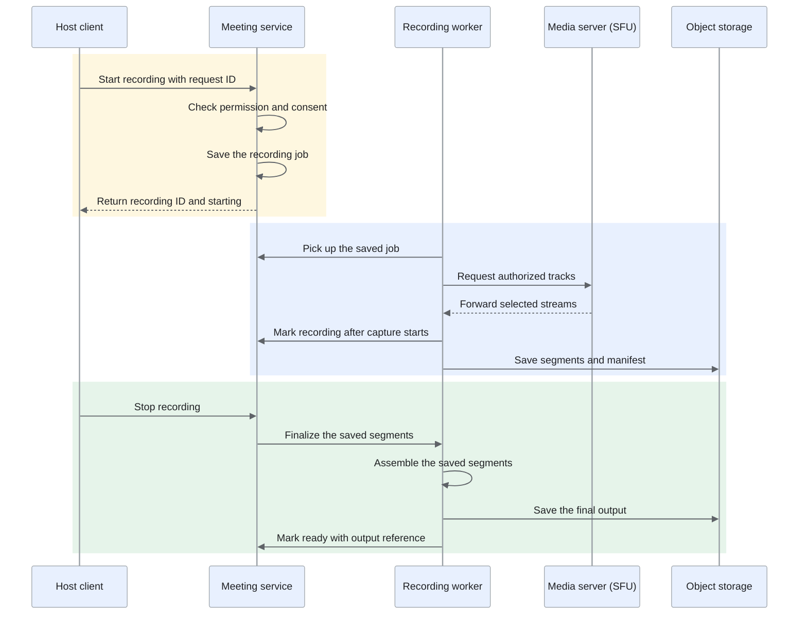
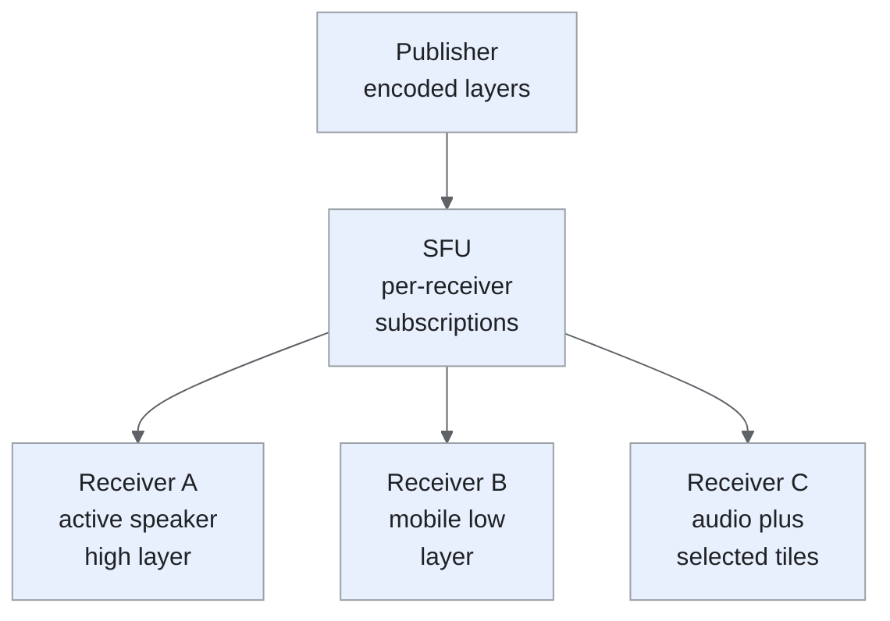
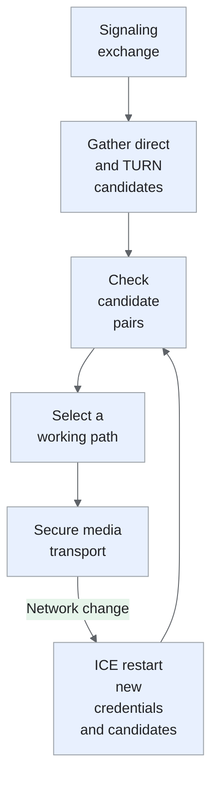
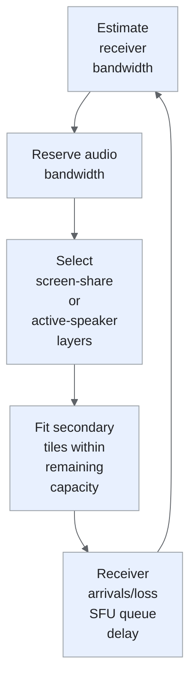
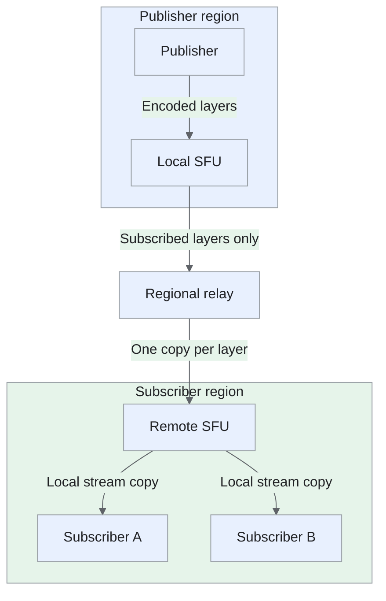

Design of a meeting service with live audio, video, screen sharing, chat and optional recording.

<!--more-->

## Problem

Users need to join a meeting quickly, hear each other clearly and share content across home, mobile and corporate networks. Each participant has a different connection and device, so the service must adapt the streams delivered to each receiver.

Meeting setup and host controls need reliable delivery. Live audio and video need to arrive in time for playback, so they use a separate transport that can favor timely packets over retransmitting outdated media.

## Requirements

### Functional requirements

- **Manage meetings:** create and join meetings, maintain the participant roster and enforce host permissions.

- **Exchange media:** send microphone and camera streams and receive other participants' audio and video.

- **Share a screen:** show a participant's screen alongside the meeting's camera feeds.

- **Adapt quality:** adjust video quality and preserve audio as network conditions change.

- **Chat and react:** deliver meeting messages and lightweight reactions.

- **Record a meeting:** save permitted audio, video and screen content for authorized users.

### Non-functional requirements

Design targets:

- **Scale:** 10M concurrent participants, including meetings with up to 1,000 participants.

- **Latency:** capture-to-playback delay under 150ms at p95 for supported regional network conditions; join within three seconds at p95.

- **Availability:** 99.9% for meeting setup; target media recovery within five seconds after a single media-server failure.

- **Security:** authenticated access and encrypted connections; optional end-to-end encryption (E2EE) keeps media decryption keys with authorized participants.

- **Resilience:** reduce video quality and preserve audio during congestion; display reconnection state when a path fails.

Intercontinental propagation, device processing and restrictive networks can exceed the latency target. Webinars, telephone dial-in and breakout rooms are outside this design.

## Back-of-the-envelope calculations

- **Media ingress:** 10M × 2Mbps average uplink = 20Tbps, before transport overhead.

- **Stream deliveries:** if all 20 participants receive everyone else's stream, the meeting has 20 × 19 = 380 receiver/stream relationships. Outbound bandwidth depends on visible tiles and their selected bitrates.

- **Connectivity relay traffic:** a relay carries media when a device cannot connect directly to the media server. With 10% of participants relaying 2Mbps in each direction, about 4Tbps of media payload crosses the relay path. Relay interfaces handle about 4Tbps ingress plus 4Tbps egress before overhead. The design uses [TURN](https://www.rfc-editor.org/rfc/rfc8656.html), the standard protocol for this relay path; measure the actual relay share and downstream bitrate mix.

- **Recording:** 5M recordings/day × 45 minutes × 1.5Mbps / 8 ≈ 2.5PB/day for one retained media stream per recording. Recording several streams separately multiplies this by the retained stream count.

Bandwidth, recording retention and per-meeting stream deliveries determine capacity; server counts require measured forwarding throughput.

## Core entities

A **track** is one microphone, camera or screen stream. The model records which participants belong to a meeting, which tracks they send and which media server handles each participant's connection.

- **Meeting:** access policy, host and current lifecycle state.

- **Participant:** identity and permissions within a meeting.

- **Media session:** the participant's connection and assigned media server.

- **Recording:** retained track objects, consent and processing state.

```protobuf
message Meeting {
  string meeting_id;
  string host_user_id;
  string status;
  string encryption_mode;         // Transport or end_to_end
  Timestamp created_at;
}

message Participant {
  string participant_id;
  string meeting_id;
  string user_id;
  string role;
  bool recording_consent;
}

message MediaSession {
  string session_id;
  string participant_id;
  string forwarding_node;          // Assigned media server
  int64 session_epoch;             // Connection version; rejects delayed commands
  int64 assignment_epoch;          // Media-server assignment version
  repeated string published_tracks; // Tracks this participant sends
}

message Recording {
  string recording_id;
  string meeting_id;
  string status;
  repeated string track_objects;  // Storage references to the saved tracks
  Timestamp started_at;
}

message ChatMessage {
  string message_id;
  string meeting_id;
  string sender_id;
  int64 sequence;                  // Order of messages within the meeting
  string body;
}

```
## API

HTTP endpoints manage meetings and recordings. A persistent, two-way [WebSocket connection](https://datatracker.ietf.org/doc/html/rfc6455) carries connection-setup messages—[signaling](#how-do-meetings-survive-restrictive-networks)—alongside host controls, chat and reactions. Audio and video use a separate encrypted media connection.

```yaml
POST /v1/meetings:
  body: {access_policy: object, encryption_mode: string}
  response: {meeting_id: string, join_url: string}

POST /v1/meetings/{meeting_id}/join:
  body: {user_token: string, device_capabilities: object}
  response: {participant_id: string, session_token: string,
             signaling_url: string, media_server: string,
             session_epoch: integer, assignment_epoch: integer}

WebSocket /v1/meetings/{meeting_id}/signal:
  message_categories: [connection_setup, track_selection,
                       host_controls, chat, reactions]

POST /v1/meetings/{meeting_id}/recordings:
  headers:
    Idempotency-Key: request_id  # Identifies one recording-start request
  response: {recording_id: string, status: starting}

POST /v1/recordings/{recording_id}/stop:
  response: {status: processing}

GET /v1/recordings/{recording_id}:
  response: {status: string, authorized_download_url: string}

```

Connection negotiation and [retry/reconnect handling](#how-do-retries-and-reconnects-preserve-the-current-session) are covered in the deep dives.

## High-level design

The meeting service checks access and assigns a media server to each participant. Each participant sends its streams to that server, which forwards the streams requested by receiving devices. Each device keeps one media-server connection as the meeting grows. This forwarding role is called a [selective forwarding unit (SFU)](https://www.rfc-editor.org/rfc/rfc9605.html#section-6.1).

A device tells the SFU which streams it wants to receive as the user changes the meeting layout. A recording worker receives authorized streams and saves them; meeting and chat records use separate storage.


## Storage

- **Relational database — [PostgreSQL](/designs/tech-postgresql/):** meeting metadata, permissions, recording jobs and retained chat need durable transactions and indexed access by meeting. Store current server assignments and command results here so recovery state survives service restarts.

- **In-memory key-value store — [Redis](/designs/tech-redis/):** cached media-server assignments and connected-participant lists need fast lookups and expiry. These are short-lived coordination records; durable permissions and assignments remain in PostgreSQL.

- **Object storage:** immutable recording segments and final outputs need large sequential writes and authorized downloads.

- **Durable job queue:** stores pending recording-finalization and retention jobs so workers can retry them after a crash, separately from the live meeting.

Chat retention follows the meeting policy. Media packets remain in bounded transport and retransmission buffers; recording is an explicit operation.

## Functional scenarios

### Creating a meeting

The host submits an access policy and encryption mode to `POST /v1/meetings`. The meeting service validates those settings, saves the meeting with the host's user ID and returns a meeting ID and join URL.

The host shares that URL with participants. Each join request is checked against the saved access policy. Participant roles determine who can change meeting controls or start a recording.

### Joining a meeting

The client sends the meeting ID, its authenticated identity and device capabilities to the join endpoint. The meeting service checks the meeting's access policy and available media capacity, then creates the participant and media-session records. It returns the participant ID, a short-lived session token, the control-connection address and the assigned media server.

The client uses that token to open its WebSocket control connection. The meeting service relays connection-setup messages to the assigned SFU and updates the participant roster—the list of users in the meeting. Once the media connection is ready, the device can send its own tracks and request tracks from other participants.



The meeting service authorizes the join and relays setup messages to the assigned SFU. The device then establishes its media connection, sends its tracks and requests the tracks it wants to receive. The SFU forwards those selected streams; a TURN relay can carry the connection on restrictive networks.

An access or capacity failure returns a clear join error. If an established connection fails, the client shows a reconnecting state and restores the connection using the same participant identity. The deep dives explain [path selection](#how-do-meetings-survive-restrictive-networks) and [session-version checks](#how-do-retries-and-reconnects-preserve-the-current-session).

### Sending and receiving audio and video

The user grants microphone or camera access, and the client captures those inputs as tracks. It compresses each track for transmission using a **codec**, an audio or video encoder/decoder. Sending a track is called **publishing**; requesting another participant's track is **subscribing**.

The client announces its published tracks through the control connection and sends their encoded media to the SFU. Other participants receive the available track IDs and request the tracks needed for their layout. A large speaker tile may need higher-quality video than a small thumbnail; changing the layout updates those requests.

For video, the sender can provide separately encoded quality versions, or a base stream with additional layers of detail. The SFU selects the version or layers that fit each receiving device's bandwidth. Receivers briefly queue incoming packets to smooth arrival-time variation, then decode and play the streams. Their network feedback lets the SFU adjust delivery as conditions change.

Audio receives priority during congestion, with video quality reduced first. Forwarding every camera at full quality grows downstream bandwidth rapidly; selective subscriptions and layer selection address that cost. The [quality-control deep dive](#how-do-we-keep-quality-consistent-across-receivers) explains the encoding and adaptation mechanisms.

### Sharing a screen

A user selects Share, and the browser prompts them to choose a tab, window or screen. This grants capture access for that sharing session, as described in the [W3C Screen Capture draft](https://www.w3.org/TR/screen-capture/#dom-mediadevices-getdisplaymedia). The meeting service separately checks whether that participant is allowed to publish a screen track, and the SFU enforces that permission.

Once authorized, the client announces the screen track and sends it alongside the camera and microphone tracks. Receiving clients request the screen track and update their layouts. The sender chooses encoding settings suited to readable text or moving content; the SFU adapts the forwarded quality for each receiver.



The control connection handles permission and track availability; the media connection carries the screen frames. Stopping sharing ends local capture, removes the published track and restores receiving layouts. Cancelling the capture prompt leaves the existing microphone and camera streams running. Host restrictions are enforced by the service, while starting device capture requires the user's local permission.

### Sending chat and reactions

The sender submits the message body and a client-generated message ID over the control connection. The meeting service checks membership, stores the message with its ID and sequence number, and acknowledges it after the database commit. That acknowledgment confirms the message is saved; delivery to other participants follows.

Each recipient orders messages by sequence and merges repeated deliveries by message ID. The client keeps the last sequence it has synchronized from stored history, separately from live notifications. Periodic catch-up and reconnect both request retained messages after that position; each completed history read advances it. Repeated submissions with the same message ID return the saved result; the [retry deep dive](#how-do-retries-and-reconnects-preserve-the-current-session) covers the transaction and replay rules.



The database commit precedes the sender's acknowledgment, and retained messages support catch-up after missed live delivery. Reactions share the WebSocket connection but are transient events: the service forwards them to connected participants and omits them from chat history. A participant who is disconnected may miss a reaction; reconnecting retrieves retained chat messages.

### Recording a meeting

The host sends a recording-start request with an `Idempotency-Key`. The meeting service checks the host's permission, the encryption mode and required participant consent, then saves a recording job. It returns the recording ID with `starting`; participants see that recording has been requested.

A recording worker picks up the saved job and requests the permitted tracks from the SFU. When capture begins, the job becomes `recording` and participants see the active recording indicator. The worker writes media segments to object storage and keeps an index of completed segments, called a **manifest**, so finalization can resume from saved segments after an interruption.



Stopping moves the job to `processing` while workers finish the segments and assemble the output. Once it is `ready`, the status endpoint returns a download URL after checking the requesting user's access. Interrupted capture is marked `failed`, with completed segments retained for recovery. Finalization can retry from the saved manifest.

Transport-encrypted meetings can support a trusted cloud recorder. End-to-end encrypted meetings require an explicitly authorized key-holding recorder or client-side recording, according to the meeting policy.

## Deep dives

### Which media topology fits group meetings?

**Problem.** A group call creates many subscriptions, and users have limited uplink and decoding capacity.

**Options and tradeoffs.**

- **Peer-to-peer mesh:** Send a separate copy from each publisher to every peer. Small calls avoid a forwarding server, but uplink and connection count grow with participants.

- **Server mixing:** Decode streams and encode a composite for each needed layout. Receiver decoding can be lighter, but server compute, latency and end-to-end trust constraints increase.

- **Selective forwarding — recommended:** Forward existing encoded streams and select subscriptions/layers per receiver. Server encoding work is avoided; receiver bandwidth and decode limits still require bounded visible tiles and layer choices.

**Choice and rationale.** In a 20-person mesh, sending a 2Mbps camera stream separately to 19 peers requires 38Mbps of upload bandwidth per participant. Selective forwarding sends a bounded set of quality versions to one media server, which distributes them to receivers. We choose it because client upload bandwidth and server encoding capacity are limited. The cost moves to server outbound bandwidth and per-receiver subscription state; mixing remains useful for authorized recording or constrained clients.

Media travels in packets carrying sequence numbers and playback timestamps, using [Real-time Transport Protocol (RTP)](https://datatracker.ietf.org/doc/html/rfc3550). These let receivers order packets and align playback. Bound visible video subscriptions so each device stays within its receive-bandwidth and decoding capacity.

Many compressed video frames describe changes relative to earlier frames. Switching quality versions can leave a receiver missing those references. The SFU switches at an independently decodable **keyframe**, or another switching point supported by the codec, and keeps a bounded history of recent packets for retransmission.

**How it works: what the SFU forwards.**

A publisher sends video using **simulcast**, several independently encoded quality versions, or **scalable video coding**, a base layer with enhancement layers that add quality. The SFU forwards a suitable version or decodable set of layers for each subscription: high quality for a large active-speaker tile, lower quality for a small mobile tile. Receiving devices decode their selected streams and compose their own meeting layouts.



**Tradeoffs and recovery.** On a layout change, the receiver requests a new subscription. The SFU requests a keyframe when needed for the switch and drops retransmissions after their playback deadline. Measure sender upload bandwidth, SFU outbound bandwidth and receiver decoding load separately. A forwarding failure requires reassignment and republishing; retained meeting metadata cannot reconstruct media packets already lost.

### How do meetings survive restrictive networks?

**Problem.** A direct media path sends individual packets without waiting for transport-level retransmission, using **User Datagram Protocol (UDP)**. This suits time-sensitive audio/video. A home router may translate a device's private address to a public address; this is **network address translation (NAT)**. That translation and firewall rules can make some advertised addresses unreachable. Connectivity checks, called [Interactive Connectivity Establishment (ICE)](https://www.rfc-editor.org/rfc/rfc8445.html), find a usable device-to-server path.

**Options and tradeoffs.**

- **Direct transport only:** Use a direct supported media candidate. Relay spending is low, but restrictive NATs or firewalls prevent some participants from connecting.

- **Relay every session:** Route all media through TURN infrastructure. Connectivity handling is uniform, but even reachable sessions pay relay bandwidth and an extra network path.

- **ICE with relay fallback — recommended:** Check candidate pairs and use a working direct or TURN path. Most sessions can avoid unnecessary relay; candidate setup, relay capacity and connectivity metrics remain required.

**Choice and rationale.** Use ICE with relay fallback because participants use heterogeneous enterprise and mobile networks. We accept connectivity-check setup and provision measured TURN capacity so reachability does not depend on one assumed UDP path.

**How it works: connection setup.**

Before audio or video can flow, the client and its assigned media server agree on supported media formats and exchange network addresses they can try. This setup exchange is [**signaling**](https://www.rfc-editor.org/rfc/rfc8829.html#section-1.1). The meeting service relays these messages over the client's WebSocket control connection. Browser clients use [Web Real-Time Communication (WebRTC)](https://www.w3.org/TR/webrtc/) to negotiate media settings, test connectivity and establish the encrypted media connection.

The client proposes media formats and connection settings in an `offer`; the media server returns its accepted settings in an `answer`. Each endpoint advertises possible network addresses in `ice_candidate` messages. ICE sends test packets across these device/server address pairs and selects a working direct or TURN-relayed path. Once connected, the client requests the tracks it wants to receive using `subscribe`.

Deploy TURN near users and require short-lived credentials. A client reserves a temporary relay address through a **TURN allocation**; monitor those reservations, relay bandwidth and transport mix. For restrictive networks, TURN can use **Transmission Control Protocol (TCP)**, encrypting the connection and authenticating the relay server with **Transport Layer Security (TLS)**. TCP delivers data in order, so a missing packet can delay newer media behind its retransmission; this is **head-of-line blocking**.

**Connection establishment and network change**

When a phone moves from Wi-Fi to cellular, its earlier media path may stop working. The client and SFU exchange fresh connection credentials and addresses through signaling, then repeat connectivity checks. This renewal is an **ICE restart**; it replaces the media path while preserving the meeting session.



Monitor the control connection and media path separately: either can fail while the other remains available. Record the selected address type, the time for a packet and reply to complete a round trip (**RTT**), packet loss and relay use to locate connectivity failures.

**Tradeoffs and recovery.** Expire relay allocations and enforce per-user abuse limits. Test enterprise firewalls and Wi-Fi-to-mobile handoff with real clients. After a path changes, estimate its capacity before restoring the previous video bitrate. Relay failure starts a new connectivity check; relay capacity shortages return a visible reconnect/join failure rather than claiming all networks meet the regional latency target.

### How do retries and reconnects preserve the current session?

**Problem.** A client can lose a response after a command succeeds, and messages from an old connection can arrive after a reconnect. The service must recognize a repeated request while keeping delayed messages from changing the current session.

**Options and tradeoffs.**

- **Retry each command as a new request:** little retained state, but a repeated recording-start or chat submission can create duplicate work.

- **Deduplicate within the live connection:** inexpensive and useful for local retries, but the cache disappears on restart and a reconnect creates a new connection.

- **Stable request IDs and service-checked versions — recommended:** retain command outcomes and check the current connection and server assignment. Retries recover the original result, while obsolete commands are rejected. This requires durable state, atomic updates and a bounded retention policy.

**Choice and rationale.** Meetings frequently reconnect and can outlive a service process. We choose stable request identities plus independent versions so a reconnect preserves the participant, a retry preserves its original operation, and a reassignment takes effect once. PostgreSQL owns the durable records; Redis caches copies for fast routing. Media servers retain established connection state during a temporary cache or placement-controller outage.

**How it works.** Each control message carries a unique `command_id`. The current connection version is `session_epoch`; reconnecting advances it. The media-server assignment version is `assignment_epoch`; changing servers advances that separately. New commands must match the current versions, keeping delayed messages from changing the current session. The join response includes both versions so the client can attach them to subsequent control messages.

```yaml
command: offer | answer | ice_candidate | subscribe | host_control | chat | reaction
command_id: client_generated_id
session_epoch: current_connection_version
assignment_epoch: current_server_assignment_version
payload: command_specific_data
```

The service first authorizes the caller and checks for a saved result under the request ID. Repeating the same operation returns that result, including after a reconnect. Scope IDs to the requesting participant or user, compare the submitted operation, and reject reuse for different input.

For a new persisted operation, a PostgreSQL transaction locks the participant's session row, checks the current versions and records the command ID, its effect and the response together. Reconnect and reassignment updates take the same row lock, serializing those changes with the command. Live media-server commands are serialized against that server's current session state so a reconnect or reassignment cannot occur between the version check and the change. A timeout after commit can therefore be retried safely; a database outage leaves new durable operations unavailable until storage recovers.

A client-generated `Idempotency-Key` identifies a recording-start request so retrying it returns the same recording job.

For chat, a PostgreSQL transaction locks the meeting-local sequence counter, assigns the next number, and saves the message, its unique ID and the updated counter together. The next writer acquires that lock after commit, keeping higher sequence numbers from becoming visible before earlier messages. Reconnecting clients replay messages after their last synchronized history position; live notifications leave that position unchanged. A repeated message ID returns the existing message.

**Tradeoffs and recovery.** Retain command results through the supported retry window. Clients stop automatic retries once that window closes and show an unresolved outcome for recovery. Measure duplicate-result hits, rejected old-version commands and replay lag. Durable command writes can pause during database failure while an already established media session continues from its live state.

### How do we keep quality consistent across receivers?

**Problem.** A fast connection and a congested mobile connection can subscribe to the same publisher.

**Options and tradeoffs.**

- **One fixed quality:** Publish and forward one bitrate/resolution. Operation is simple, but a congested receiver stalls or a fast receiver receives unnecessarily low quality.

- **Per-receiver transcoding:** Decode and re-encode a tailored stream for every receiver. Adaptation is flexible, but compute and latency scale with subscriptions.

- **Encoded layers with receiver feedback — recommended:** Select a simulcast or scalable-codec layer per subscription and adjust sender bitrate as needed. Heterogeneous receivers share published layers; publishers spend extra encoding/uplink and transitions need congestion control.

**Choice and rationale.** Use encoded layers with receiver feedback because a meeting contains different devices and bandwidth conditions. We accept layer-management and publisher overhead to preserve audio and useful visible video without individualized server transcoding.

**How it works.** Receiving devices report packet arrivals and losses. The SFU combines these reports with the delay in its outgoing packet queue to estimate each receiver's available bandwidth. It reduces forwarded video bitrate as congestion grows. Receivers briefly hold arriving packets to smooth timing variation; this **jitter buffer** has a fixed delay budget so buffering preserves the playback target.

**Allocate bandwidth per receiver**

Reserve the estimated bandwidth for audio first, then screen content or the active speaker, then other selected tiles. Choose encoded layers that fit the remaining capacity; request a lower sender bitrate when the available versions are too large.



Require sustained spare bandwidth before upgrading quality; this **hysteresis** prevents small fluctuations from repeatedly switching layers. Downgrade sooner when loss or queue delay rises, and stop retransmitting packets after their playback deadline. Longer jitter buffering adds conversation delay, so keep it within the playback budget.

**Tradeoffs and recovery.** Each receiver has its own quality selection; sender processing and upload capacity still limit the available versions. Test packet loss, bursty delay, mobile handoff and changing layouts. Measure audio interruptions and frozen-frame time alongside bitrate. When capacity estimates become uncertain, use a conservative video layer and preserve audio before probing upward again.

### How do we route a meeting across regions?

**Problem.** One region is operationally simple, but users far from that region pay extra propagation delay.

**Options and tradeoffs.**

- **One meeting region:** Keep all media on one regional forwarding group. Ownership and relay relationships are simple, but distant participants pay additional propagation delay.

- **Independent nearest-server placement:** Attach each participant to the nearest available SFU. Access paths are short, but participants spread across many nodes can require many node-to-node relay connections and separate copies of the same stream.

- **Regional SFU groups — recommended:** Group nearby participants on a regional set of media servers. Combine their requested tracks so each required stream crosses regions once per receiving group, then distribute it locally. This bounds relay copies, while routing and recovery must preserve subscriptions and server-assignment versions.

**Choice and rationale.** Use regional SFU groups because large meetings can span regions while only selected tracks are visible. We accept cross-region routing state and measured relay bandwidth, keeping small local meetings on the simpler one-region path.

**How it works.** The meeting service's **placement controller** chooses a media server using participant locations, capacity and data-residency requirements, and records the assignment version. Media servers retain current connection and subscription state so established media can continue during a controller restart.

On SFU failure, clients receive a new assignment, establish a new transport and republish or resubscribe. Capacity reserves and regional admission limits keep failover from overloading healthy nodes. Measure recovery against the five-second target under the supported network conditions.

**A cross-region subscription**

Assign each participant to a nearby SFU with available capacity. An **inter-region relay** carries the required streams between regional SFUs when subscribers are in another region; the receiving SFU distributes them locally. This connects media servers to one another, while TURN handles a device's connectivity to its SFU.



After a media-server failure, receivers resume restored video subscriptions from a keyframe.

**Tradeoffs and recovery.** Reserve failover capacity before accepting meetings at the advertised target. Reassignment advances `assignment_epoch`. Once a client has received a newer assignment, it discards older assignment responses; media servers reject commands carrying old assignment or connection versions. These checks prevent delayed control messages from overriding newer session state. Data-residency constraints can override nearest-region placement; expose that policy to the participant.

### How does end-to-end encryption change recording and trust?

**Problem.** Transport encryption secures each client/server leg. End-to-end encryption additionally protects media payloads from the forwarding service, changing which recording operations are possible.

**Options and tradeoffs.**

- **Transport encryption:** Encrypt each client/server leg while trusted servers can process media. Recording and mixing are available, but the service remains inside the content trust boundary.

- **Client-managed media encryption:** Encrypt payloads with endpoint-held keys beyond transport security. Forwarders cannot read content, but key distribution, device trust and recording features require endpoint support.

- **Explicit meeting trust modes — recommended:** Choose and disclose a compatible encryption/recording mode before joining. Capabilities have a clear trust contract; mode negotiation and participant-visible changes add product and key-management work.

**Choice and rationale.** A recorder needs media decryption keys to save readable content. In transport-encrypted mode, a trusted server can record; in E2EE mode, recording requires an authorized participant or client that holds the keys. We choose explicit meeting modes so users can see which devices or services can access the media before joining.

**How it works.** In E2EE mode, clients encrypt media frames before sending them to the SFU, which uses visible routing metadata to forward them. [Secure Frame (SFrame)](https://www.rfc-editor.org/rfc/rfc9605.html) provides a standardized frame-encryption format. Authorized devices establish shared media keys through a reviewed, [authenticated group-key exchange](https://www.rfc-editor.org/rfc/rfc9420.html#section-1). The meeting service relays encrypted key-exchange messages; the media keys remain with authorized devices and are updated as membership changes.

A member who receives media keys can access that meeting's media. Membership verification, consent and client security therefore remain part of the trust model.

**Trust boundaries and recording**

In transport-encrypted mode, the SFU terminates the transport and trusted server recording can process payloads. In client-managed media encryption mode, forwarding uses routing metadata while payload decryption belongs to authorized meeting members.

```mermaid
%%{init: {"theme":"base","themeVariables":{"primaryColor":"#e8f0fe","primaryBorderColor":"#9aa0a6","primaryTextColor":"#202124","secondaryColor":"#e6f4ea","tertiaryColor":"#fef7e0","lineColor":"#5f6368","actorBkg":"#e8f0fe","actorBorder":"#9aa0a6","actorTextColor":"#202124","noteBkgColor":"#fef7e0","noteBorderColor":"#9aa0a6","noteTextColor":"#202124","signalColor":"#5f6368","signalTextColor":"#202124"}}}%%
flowchart TB
  subgraph TRANSPORT["Transport encryption · service can process media"]
    T1["Sending client"] <-->|"Encrypted transport"| S["Media server<br>(SFU)<br>can decode or<br>record"]
    S <-->|"Encrypted transport"| T2["Receiving<br>client"]
  end
  subgraph E2EE["End-to-end encryption · clients hold media keys"]
    E1["Authorized<br>sending client<br>encrypts<br>payload"] -->|"Encrypted media"| F["Media server<br>(SFU)<br>routing<br>metadata only"]
    F -->|"Encrypted media"| E2["Authorized<br>receiving<br>client<br>decrypts<br>payload"]
  end
  style TRANSPORT fill:#fef7e0,stroke:#9aa0a6,color:#202124
  style E2EE fill:#e6f4ea,stroke:#9aa0a6,color:#202124
classDef request fill:#e8f0fe,stroke:#9aa0a6,color:#202124;
classDef data fill:#e6f4ea,stroke:#9aa0a6,color:#202124;
classDef control fill:#fef7e0,stroke:#9aa0a6,color:#202124;
classDef danger fill:#fce8e6,stroke:#9aa0a6,color:#202124;
class T1,S,T2,E1,F,E2 request;
```



Give each sender distinct media keys and an increasing frame counter; receivers reject replayed frames. A sender restarts its counter only after changing its key, keeping each encryption key/counter pair unique. After a member leaves or is removed, deliver fresh keys only to remaining authorized devices. Previously received keys or decoded media remain part of the prior trust exposure. Authenticate the participant list and host actions so signaling manipulation cannot silently add a receiver.

**Tradeoffs and recovery.** Display the encryption mode, recording consent and authorized recorder before joining. Verify key updates after participant removal and admission of a late-joining device against the reviewed protocol version. A failed key update pauses affected encrypted media until members recover a valid group state; it never silently downgrades the meeting to service-readable media.
